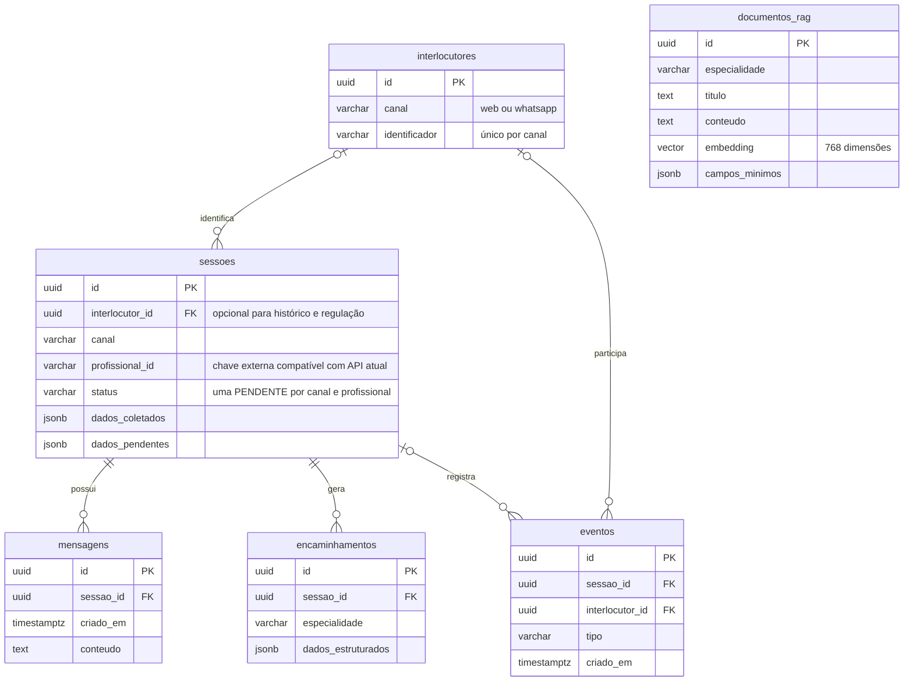

# Banco de Dados

PostgreSQL 16 com **pgvector 0.8.2**, executado em Docker. O backend usa SQL parametrizado
com o driver `pg`, sem ORM ou SDK do Supabase. `services/database.ts` e `services/rag.ts`
compartilham o pool de `services/pool.ts`.

::: info Implementação e produção
Esta documentação descreve o modelo implementado na branch de migração. A publicação
da documentação não realiza o corte de produção: a transferência dos dados e a troca
do backend seguem o [procedimento de migração](/migracao-postgresql).
:::

São **seis tabelas de aplicação** e uma tabela técnica de controle de migrações.
O schema canônico está em `backend/src/database/migrations/001_baseline.sql` e
`002_integridade_indices.sql`; os arquivos SQL antigos soltos não são o bootstrap.

## Relacionamentos

`documentos_rag` é independente das sessões. Ao excluir uma sessão, suas mensagens e
encaminhamentos são excluídos em cascata; eventos permanecem com `sessao_id = NULL`.
Ao excluir um interlocutor, sessões e eventos permanecem com `interlocutor_id = NULL`.
Definir a política de retenção antes de disponibilizar exclusões na aplicação.

## Dicionário de dados

Todas as PKs de aplicação são UUIDs gerados com `gen_random_uuid()`. Datas usam
`timestamptz` e recebem `CURRENT_TIMESTAMP`. A coluna “Nulo?” indica se SQL NULL é
permitido; um campo JSON opcional não equivale a uma coluna relacional opcional.

### `interlocutores`

Perfil do profissional por canal. A identidade é o par `(canal, identificador)`, não apenas o identificador.

| Coluna | Tipo | Nulo? | Regra / uso |
|---|---|---|---|
| `id` | `uuid` | Não | PK; gerado automaticamente |
| `canal` | `varchar(20)` | Não | `web` ou `whatsapp` |
| `identificador` | `varchar(255)` | Não | Identidade externa, única por canal |
| `nome` | `varchar(120)` | Sim | Nome informado/capturado |
| `unidade_cnes` | `varchar(20)` | Sim | Código da unidade; não é FK neste modelo |
| `criado_em` | `timestamptz` | Não | Data de criação |

### `sessoes`

Estado da conversa. Só pode existir uma sessão `PENDENTE` por `(canal, profissional_id)`; sessões encerradas permanecem no histórico.

| Coluna | Tipo | Nulo? | Regra / uso |
|---|---|---|---|
| `id` | `uuid` | Não | PK |
| `profissional_id` | `varchar(255)` | Não | Chave externa mantida por compatibilidade; regulação usa sufixo `::regulacao` |
| `canal` | `varchar(20)` | Não | `web` (padrão) ou `whatsapp` |
| `interlocutor_id` | `uuid` | Sim | FK → `interlocutores.id`; histórico/regulação podem não ter perfil |
| `agente_atual` | `varchar(50)` | Não | Padrão: `orquestrador` |
| `status` | `varchar(20)` | Não | `PENDENTE` (padrão), `FINALIZADO`, `NAO_ELEGIVEL` ou `ABANDONADA` |
| `dados_coletados` | `jsonb` | Não | Objeto; padrão `{}` |
| `dados_pendentes` | `jsonb` | Não | Array; padrão `[]` |
| `criado_em` | `timestamptz` | Não | Data de criação |
| `atualizado_em` | `timestamptz` | Não | Atualizado por trigger a cada UPDATE |

### `mensagens`

Histórico textual e telemetria de cada mensagem. O zero de tokens é preservado; NULL significa que a contagem não foi informada.

| Coluna | Tipo | Nulo? | Regra / uso |
|---|---|---|---|
| `id` | `uuid` | Não | PK |
| `sessao_id` | `uuid` | Não | FK → `sessoes.id`; ON DELETE CASCADE |
| `remetente` | `varchar(20)` | Não | `profissional`, `bot` ou `system` |
| `conteudo` | `text` | Não | Texto da mensagem |
| `modelo_usado` | `varchar(100)` | Sim | Identificador do modelo |
| `tokens_prompt` | `integer` | Sim | Contagem não negativa |
| `tokens_resposta` | `integer` | Sim | Contagem não negativa |
| `fontes_rag` | `jsonb` | Sim | Fontes utilizadas na resposta |
| `criado_em` | `timestamptz` | Não | Data de criação |

### `encaminhamentos`

Resultado estruturado do caso. Não há restrição de um encaminhamento por sessão: essa regra de negócio não foi assumida.

| Coluna | Tipo | Nulo? | Regra / uso |
|---|---|---|---|
| `id` | `uuid` | Não | PK |
| `sessao_id` | `uuid` | Não | FK → `sessoes.id`; ON DELETE CASCADE |
| `especialidade` | `varchar(100)` | Não | Especialidade do encaminhamento |
| `classificacao_risco` | `varchar(50)` | Sim | Classificação de risco |
| `resumo_sisreg` | `text` | Sim | Texto final |
| `elegivel` | `boolean` | Não | Elegibilidade |
| `dados_estruturados` | `jsonb` | Não | Objeto; padrão `{}` |
| `criado_em` | `timestamptz` | Não | Data de criação |

### `eventos`

Fatos de uso para o painel. A aplicação registra metadados, sem copiar relato clínico ou mensagens para esta tabela.

| Coluna | Tipo | Nulo? | Regra / uso |
|---|---|---|---|
| `id` | `uuid` | Não | PK |
| `tipo` | `varchar(30)` | Não | `caso_iniciado`, `texto_gerado`, `nao_elegivel` ou `urgencia` |
| `especialidade` | `varchar(50)` | Sim | Especialidade associada |
| `sessao_id` | `uuid` | Sim | FK → `sessoes.id`; ON DELETE SET NULL |
| `interlocutor_id` | `uuid` | Sim | FK → `interlocutores.id`; ON DELETE SET NULL |
| `dados` | `jsonb` | Não | Objeto de metadados; padrão `{}` |
| `criado_em` | `timestamptz` | Não | Data do evento |

### `documentos_rag`

Um registro por trecho de Nota Técnica. O vetor usa 768 dimensões e distância de cosseno. Consulte [RAG](/rag) para ingestão e busca.

| Coluna | Tipo | Nulo? | Regra / uso |
|---|---|---|---|
| `id` | `uuid` | Não | PK |
| `especialidade` | `varchar(50)` | Não | Filtro da busca |
| `titulo` | `text` | Não | Título do trecho |
| `conteudo` | `text` | Não | Texto do trecho |
| `embedding` | `vector(768)` | Não | Embedding gerado pelo Gemini |
| `campos_minimos` | `jsonb` | Não | Array de campos obrigatórios; padrão `[]` |
| `criado_em` | `timestamptz` | Não | Data de ingestão |

### `schema_migrations`

Controle técnico criado pelo runner. A API não tem acesso a esta tabela.

| Coluna | Tipo | Nulo? | Regra / uso |
|---|---|---|---|
| `version` | `text` | Não | PK; nome do arquivo SQL |
| `checksum` | `text` | Não | SHA-256 do conteúdo aplicado |
| `applied_at` | `timestamptz` | Não | Padrão `now()` |

## Índices e consultas atendidas

As PKs e a unicidade de interlocutores criam seus próprios índices. Os demais são:

| Tabela | Índice / colunas | Objetivo |
|---|---|---|
| `interlocutores` | `(identificador)` | Localização da identidade externa |
| `sessoes` | `(profissional_id)` | Consultas por profissional |
| `sessoes` | Único `(canal, profissional_id)` onde `status = 'PENDENTE'` | Impedir duas sessões ativas por identidade |
| `sessoes` | `(interlocutor_id)` não nulo | Relacionamento com o perfil |
| `mensagens` | `(sessao_id, criado_em, id)` | Histórico ordenado e FK |
| `encaminhamentos` | `(sessao_id)` | Relacionamento com a sessão |
| `encaminhamentos` | `(criado_em DESC, id DESC)` | Lista recente do painel |
| `eventos` | Índices separados em `tipo`, `especialidade`, `criado_em` | Consultas de telemetria e período |
| `eventos` | Índices parciais em `sessao_id` e `interlocutor_id` não nulos | FKs e operações de exclusão |
| `documentos_rag` | `(especialidade)` | Filtro por especialidade |
| `documentos_rag` | HNSW em `embedding`, `vector_cosine_ops` | Busca aproximada por cosseno |

Os antigos GIN de `dados_coletados` e `dados_estruturados` foram removidos porque
as consultas atuais não filtram o conteúdo desses JSONs. Também foram substituídos
o índice isolado de status e o índice simples de sessão em mensagens.

## Concorrência e identidade

Criação e encerramento de sessão usam transação e advisory lock por canal/identificador.
O índice único parcial é a garantia final de unicidade. O perfil usa upsert para
suportar criação concorrente. A sessão guarda a FK do interlocutor, e o painel faz
JOIN pelo UUID, evitando misturar perfis com o mesmo identificador em canais diferentes.
Perfis cadastrados depois de sessões sem vínculo são associados ao retomar a sessão.

Isso não serializa a conversa inteira: filas para chamadas ao LLM e idempotência de
webhooks ainda são evoluções da aplicação. O UUID desempata mensagens com mesmo
horário, mas não define ordem causal entre mensagens simultâneas.

## Migrações, permissões e crescimento

O runner aplica SQL em ordem, com lock global, transação por arquivo e checksum.
Alterar um arquivo já aplicado causa erro; novas mudanças exigem nova migração.
Dados legados inválidos ou identidades ambíguas bloqueiam a migração, sem exclusão
ou correção clínica automática. Veja [Migração e backup](/migracao-postgresql).

A API usa `petsaude_app`: leitura/escrita nas cinco tabelas transacionais e apenas
leitura na base RAG. Migração, ingestão e backup usam a conta proprietária.
[Infraestrutura](/infraestrutura) descreve limites de conexão e credenciais.

Não foi adicionado particionamento sem evidência de volume. Medir planos, latência,
disco e retenção antes de adotá-lo. O painel ainda agrega eventos no Node; agregação
SQL e paginação por cursor são próximas opções caso o volume exija.
