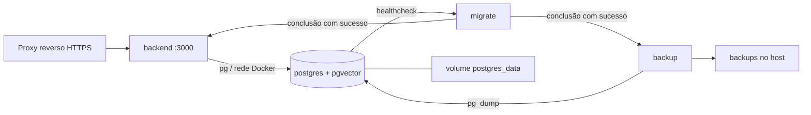

# Infraestrutura

O repositório oferece `docker-compose.yml` para executar **PostgreSQL 16 + pgvector
0.8.2, backend Node 22, migrador e backup no mesmo host**. Essa é a infraestrutura
implementada para substituir o Supabase; a mudança efetiva de produção depende do
[corte e validação dos dados](/migracao-postgresql).

## Componentes

| Serviço | Papel | Persistência / acesso |
|---|---|---|
| `postgres` | Banco transacional e vetorial | Volume `postgres_data`; sem publicar 5432 no host |
| `migrate` | Aplica migrações e provisiona conta da API | Executa até concluir; usa conta proprietária |
| `backend` | Express, chatbot, painel e RAG | Publica `127.0.0.1:3000` por padrão |
| `backup` | Dump ao iniciar e a cada 24 horas | Arquivos em `./backups`; retenção padrão de 7 dias |
| OpenRouter | Modelo de conversação | Serviço externo |
| Gemini | Embeddings 768d | Serviço externo; reingestão consome API |
| Evolution API | Integração WhatsApp | Configuração externa ao Compose |
| GitHub Pages | Este site VitePress | Publicado pelo workflow de documentação da `main` |

O proxy e a cópia externa dos backups precisam ser configurados no servidor; não
são serviços incluídos neste Compose. Frontend e Evolution API também não fazem
parte desse arquivo.

## Configuração

Copiar `.env.example` para `.env`, preencher as senhas e as chaves dos provedores,
e executar `docker compose up -d --build`. Procedimento completo em
[Migração e backup](/migracao-postgresql).

| Variável | Uso / padrão |
|---|---|
| `POSTGRES_PASSWORD` | Senha da conta proprietária usada por migração e backup |
| `APP_DB_PASSWORD` | Senha diferente, com pelo menos 16 caracteres, para `petsaude_app` |
| `BACKEND_PORT` | Porta local do backend; `3000` |
| `DB_POOL_MAX` | Máximo de conexões do pool compartilhado; `10` |
| `DB_BASELINE_EXISTING` | `false`; adoção explícita de schema restaurado usa `true` |
| `BACKUP_RETENTION_DAYS` | Retenção local; `7` |
| `OPENROUTER_API_KEY`, `GEMINI_API_KEY` | Credenciais dos provedores de IA |
| `EVOLUTION_API_URL`, `EVOLUTION_API_KEY`, `EVOLUTION_INSTANCE` | Canal WhatsApp |

Fora do Compose, o driver aceita `DATABASE_URL` ou `PGHOST`, `PGPORT`, `PGDATABASE`,
`PGUSER`, `PGPASSWORD`. A API recebe a conta restrita; migração e ingestão recebem a
conta proprietária. Não desabilitar validação de certificado para conexões remotas.

O pool aceita ainda `DB_CONNECT_TIMEOUT_MS=5000`, `DB_IDLE_TIMEOUT_MS=30000` e
`DB_STATEMENT_TIMEOUT_MS=30000`. Esses três parâmetros podem ser usados na execução
fora do Compose ou adicionados ao `environment` do serviço; o arquivo atual do
Compose só expõe `DB_POOL_MAX`. A soma dos pools de todas as réplicas deve reservar
conexões para administração e backup.

## Operação e limites

- O migrador aguarda PostgreSQL saudável; backend e backup aguardam o migrador.
- O volume do banco sobrevive à recriação dos containers. Não usar `down -v` em produção.
- `/health` verifica HTTP, não a integridade do banco. Monitorar conexões, disco,
  consultas lentas, falhas e idade do último backup.
- Backup no mesmo host não protege contra perda do servidor. Providenciar cópia
  cifrada externa e teste periódico de restauração.
- Compartilhar o host reduz tráfego de rede, mas concentra falhas e disputa por
  CPU/RAM. Esta configuração não oferece alta disponibilidade.

O deploy anterior usa Render e Supabase. Não se deve assumir que esse ambiente
executa o Compose: selecionar um host com Docker e disco persistente antes do corte.
O limite de memória do ambiente anterior motivou o uso de embeddings via Gemini;
a migração do banco não transforma os embeddings em processamento local.
