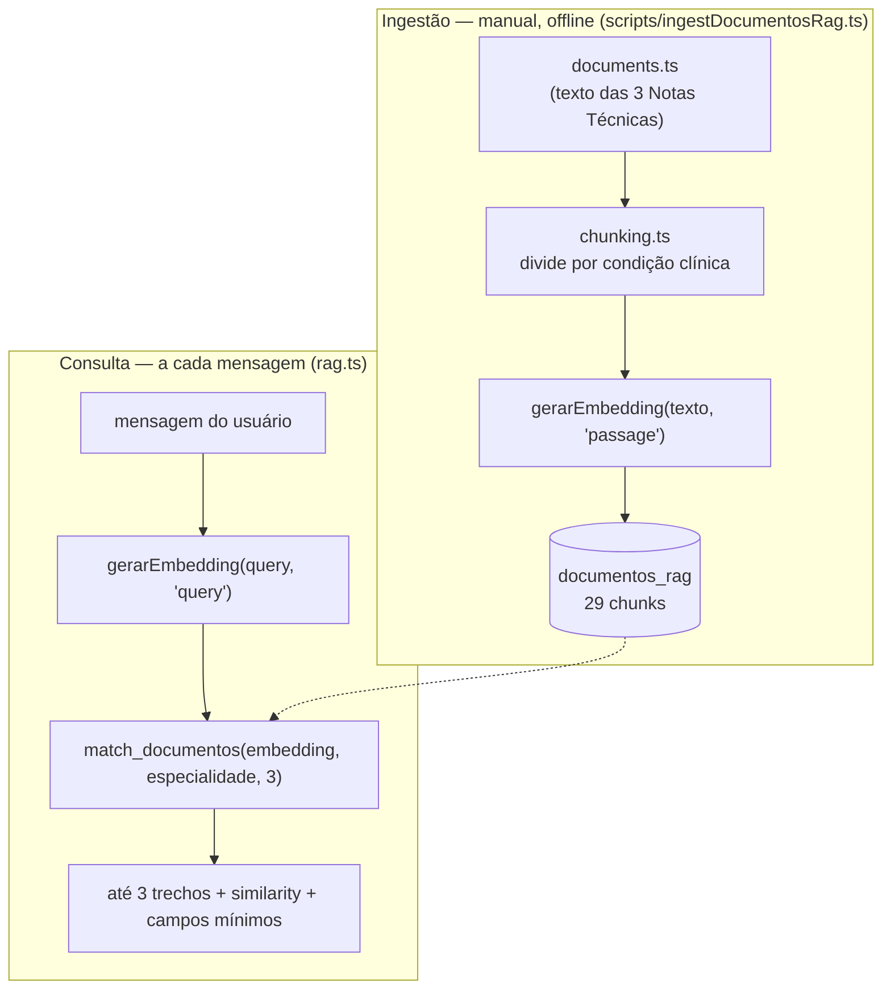

# Recuperação de Conhecimento (RAG)

A consulta usa PostgreSQL com pgvector, sem LangChain ou SDK do Supabase. A mudança
para Docker preserva os embeddings e o contrato de busca. Veja o [schema](/banco-de-dados)
e o [procedimento de migração](/migracao-postgresql).

Em vez de injetar a Nota Técnica inteira (centenas de linhas) em todo turno da conversa — o design
original, abandonado por estourar o orçamento de contexto do modelo e causar respostas cortadas —
o sistema recupera **até 3 trechos mais relevantes por padrão na aplicação** para a pergunta atual. A ingestão (offline)
e a consulta (a cada mensagem) são fases completamente separadas.



Ingestão e consulta usam a mesma função de embedding, mas nunca rodam no mesmo caminho de execução.

## Ingestão

O script `backend/src/scripts/ingestDocumentosRag.ts`:

1. Lê o texto bruto das 3 Notas Técnicas de `core/documents.ts`.
2. Divide cada documento em **chunks** — um por condição clínica — usando `core/chunking.ts`. O
   regex reconhece 3 convenções de cabeçalho diferentes usadas nos documentos-fonte
   (`## Consulta em Cardiologia - X`, `Consulta em Endocrinologia - X` sem numeração, e
   `N. Consulta em Dermatologia - X` — às vezes sem repetir "Consulta em", como em `6. Micoses`).
   Resultado: **8 chunks de cardiologia, 10 de dermatologia, 11 de endocrinologia** (29 no total).
3. Gera o embedding de cada chunk com `gerarEmbedding(texto, 'passage')`.
4. Insere `{especialidade, titulo, conteudo, campos_minimos, embedding}` na tabela `documentos_rag`.

O script começa com `TRUNCATE TABLE documentos_rag`: uma falha durante a ingestão
pode deixar a base vazia ou incompleta. Execute com conta proprietária, backup e
janela de manutenção. Ele não roda no bootstrap; um dump/restore preserva os vetores
sem consumir novamente a API. Para reingestão manual, a partir de `backend/`:

```bash
npx tsx src/scripts/ingestDocumentosRag.ts
```

## Consulta

Dentro de `services/rag.ts`, a função `buscarContexto(query, agenteAtual, limite = 3)`:

1. Se `agenteAtual` não for uma das 3 especialidades (ex: `duvidas_gerais`), retorna vazio
   imediatamente, sem chamar nenhuma API.
2. Gera o embedding da mensagem do usuário com `gerarEmbedding(query, 'query')` — mesmo modelo do
   Gemini, mas com `taskType: RETRIEVAL_QUERY` em vez de `RETRIEVAL_DOCUMENT`.
3. Chama a função SQL `match_documentos(embedding, especialidade, 3)`, que filtra por
   `especialidade` e ordena pelos chunks mais próximos por distância de cosseno.
4. Concatena o conteúdo dos chunks recuperados (até o limite solicitado), e retorna também a lista de fontes
   (`{titulo, similarity}`). A checklist `camposMinimos` vem somente do primeiro resultado.

```sql
CREATE OR REPLACE FUNCTION match_documentos(
  query_embedding vector(768),
  especialidade_filtro varchar(50),
  match_count int DEFAULT 4
) RETURNS TABLE (titulo text, conteudo text, campos_minimos jsonb, similarity float)
LANGUAGE plpgsql AS $$
BEGIN
  RETURN QUERY
  SELECT d.titulo, d.conteudo, d.campos_minimos, 1 - (d.embedding <=> query_embedding) AS similarity
  FROM documentos_rag d
  WHERE d.especialidade = especialidade_filtro
  ORDER BY d.embedding <=> query_embedding
  LIMIT match_count;
END;
$$;

ALTER FUNCTION match_documentos(vector, varchar, int)
  SET hnsw.iterative_scan = 'strict_order';
```

## Rastreabilidade

Cada resposta salva, na coluna `fontes_rag` da tabela `mensagens`, quais trechos (título +
similaridade de cosseno) embasaram aquela resposta específica — dá para auditar depois qual parte
da Nota Técnica o bot usou para decidir `FINALIZADO` ou `NAO_ELEGIVEL` num caso real.

## Por que não é LangChain

Não há `SupabaseVectorStore` nem SDK de terceiros no caminho de consulta — uma chamada HTTP ao Gemini para o vetor e uma consulta SQL ao PostgreSQL por
`pool.query`, usando o mesmo driver `pg` do resto do backend. Isso mantém a peça de embedding **desacoplada** de qual LLM
gera a resposta final: trocar o provedor de chat (veja [Modelos de IA](/modelos-ia)) nunca exige
tocar no RAG, e vice-versa.

::: tip Por que Gemini e não um modelo local?
Um modelo de embedding local (`@xenova/transformers`, sem nenhuma API externa) foi avaliado e
descartado: mediu-se ~732MB de RSS só para carregar o modelo quantizado, acima do limite de 512MB
do Render free. Ver [Infraestrutura](/infraestrutura).
:::


## Índice e permissões

O índice HNSW usa cosseno; o B-tree de especialidade atende ao filtro. A migração
habilita `hnsw.iterative_scan = strict_order` na função, permitindo ampliar a busca
quando o filtro descarta candidatos. A busca continua aproximada e sujeita aos
limites do índice; medir recall e latência com o corpus real.

A função SQL mantém `match_count DEFAULT 4`, enquanto `buscarContexto` envia o
limite padrão 3 explicitamente. `petsaude_app` pode consultar RAG e executar a função,
mas não pode alterar ou apagar os documentos. A ingestão usa a conta proprietária.
O modelo e as 768 dimensões devem permanecer compatíveis entre ingestão e consulta.
