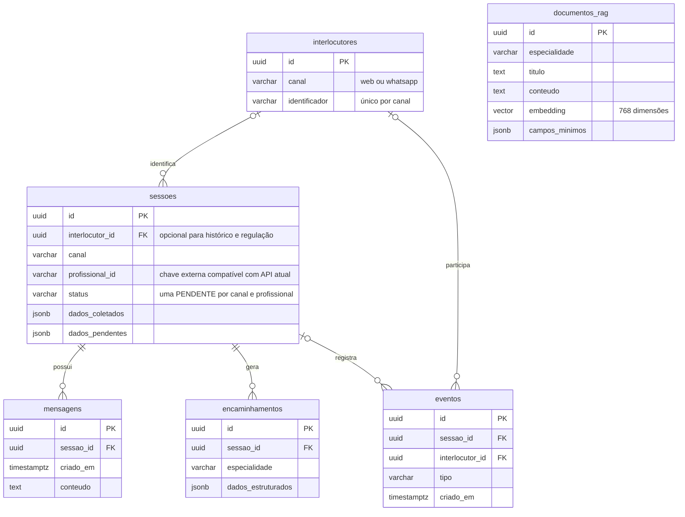

# PostgreSQL próprio: modelagem e operação

Esta branch prepara a migração; não modifica o Supabase nem o deploy de produção.
PostgreSQL 16 + pgvector 0.8.2, API Node 22 e backup ficam no mesmo Compose. A
aplicação continua usando `pg`, sem ORM ou SDK do Supabase.

## Modelo implementado



- `interlocutores`: unicidade `(canal, identificador)`, criação concorrente com upsert.
- `sessoes`: FK direta ao perfil elimina associação ambígua no painel. A criação e
  o encerramento usam lock transacional por identidade; índice único parcial
  `(canal, profissional_id) WHERE status = 'PENDENTE'` impede duplicação. Casos
  finalizados permanecem no histórico. Regulação mantém o sufixo `::regulacao`.
- `mensagens`: índice `(sessao_id, criado_em, id)` atende histórico e ordenação.
  O UUID desempata timestamps, mas não representa ordem causal entre mensagens simultâneas.
- `encaminhamentos`: índice `(criado_em DESC, id DESC)` atende lista recente;
  índice de sessão permanece. Não foi imposta unicidade por sessão sem regra de negócio que a justifique.
- `eventos`: índices das FKs foram adicionados; índice por data atende o painel.
  Ao excluir uma sessão/interlocutor, a telemetria permanece com FK nula.
- `documentos_rag`: continua sendo uma linha por chunk. Mantém índice B-tree por
  especialidade e HNSW com cosseno; busca iterativa reduz perda de candidatos após
  filtro. A busca continua aproximada: medir recall e latência com corpus real.
- JSONB é reservado para estado variável, checklist e payloads. Checks garantem
  objetos/arrays; colunas de estado e datas deixam de aceitar NULL. Removidos GIN
  de campos que o código não consulta internamente, reduzindo custo de escrita.
- Tokens negativos são rejeitados e zero é preservado, em vez de convertido em NULL.
- API e RAG compartilham um pool limitado, com timeouts configuráveis.

Mantida a exclusão em cascata de mensagens e encaminhamentos ao apagar sessões,
como no schema anterior. Definir política de retenção antes de disponibilizar
operações de exclusão. Não há particionamento antecipado: só adotar após medir
volume, retenção e planos com `EXPLAIN (ANALYZE, BUFFERS)` em homologação.
O painel ainda carrega eventos do período para agregar no Node; agregação SQL e
paginação por cursor são próximas evoluções se o volume justificar.
A exclusividade da sessão não serializa chamadas ao LLM: processamento concorrente
no mesmo chat e deduplicação de webhooks ainda requerem fila/idempotência na aplicação.

## Subir uma instalação nova

```sh
cp .env.example .env
# Preencha duas senhas diferentes (APP_DB_PASSWORD com pelo menos 16 caracteres),
# e as chaves dos serviços utilizados.
docker compose up -d --build
```

Postgres não publica porta no host. Backend publica em `127.0.0.1:3000`; configurar
proxy reverso HTTPS no servidor. `migrate` aguarda o banco saudável e o backend
aguarda o migrador terminar. O usuário `petsaude_app` não é superusuário, não altera
schema e apenas lê RAG; o usuário proprietário fica com migração/backup/ingestão.
O volume `postgres_data` persiste os dados. **Não executar `down -v` em produção.**

Fora do Compose, use `DATABASE_URL` ou as variáveis padrão `PGHOST`, `PGPORT`,
`PGDATABASE`, `PGUSER`, `PGPASSWORD`. TLS remoto deve validar certificado; não
há desativação global de verificação SSL. Parâmetros opcionais do pool:
`DB_POOL_MAX=10`, `DB_CONNECT_TIMEOUT_MS=5000`, `DB_IDLE_TIMEOUT_MS=30000`,
`DB_STATEMENT_TIMEOUT_MS=30000`. A soma dos pools de todas as réplicas deve deixar
conexões disponíveis para administração e backup.

```sh
cd backend
npm ci
npm run db:migrate
npm run build
npm start
```

SQL versionado em `src/database/migrations/001_baseline.sql` e `002_integridade_indices.sql`.
O runner usa lock global, transação por arquivo e checksum em `schema_migrations`.
Não alterar arquivo já aplicado: criar a próxima migração numerada. As migrações
antigas soltas são apenas histórico e **não devem ser executadas pelo bootstrap**;
`migration_rag.sql` é destrutiva. A construção copia SQL para `dist`.
Índices são criados transacionalmente nesta migração inicial: executar na janela
de manutenção, sobre a cópia restaurada, antes de habilitar tráfego.

## Migrar os dados existentes (preferência: preservar)

1. Ensaiar em homologação. Parar escritores/ingestão no corte final e manter o
   Supabase intacto para rollback. Conferir versão do servidor de origem; o cliente
   `pg_dump` deve suportá-la e downgrade de servidor não é garantido.
2. Exportar somente as seis tabelas da aplicação com cliente compatível e conexão
   direta ao banco (não pooler de transações). Em uma máquina com ferramentas PG:

   ```sh
   pg_dump "$SOURCE_DATABASE_URL" --format=custom --no-owner --no-acl \
     -t public.interlocutores -t public.sessoes -t public.mensagens \
     -t public.encaminhamentos -t public.eventos -t public.documentos_rag \
     --file=app.dump
   ```

3. No destino novo, subir **somente** `docker compose up -d postgres`. Criar extensão
   e restaurar antes de executar o migrador. O dump seletivo não leva funções e
   dependências externas às tabelas; instalar as funções explicitamente:

   ```sh
   docker compose exec -T postgres psql -U petsaude -d petsaude -v ON_ERROR_STOP=1 -c 'CREATE EXTENSION IF NOT EXISTS vector'
   docker compose exec -T postgres psql -U petsaude -d petsaude -v ON_ERROR_STOP=1 <<'SQL'
   CREATE OR REPLACE FUNCTION update_atualizado_em_column() RETURNS trigger
   LANGUAGE plpgsql AS $$ BEGIN NEW.atualizado_em = CURRENT_TIMESTAMP; RETURN NEW; END $$;
   SQL
   docker compose exec -T postgres pg_restore -U petsaude -d petsaude --no-owner --no-acl --exit-on-error < app.dump
   docker compose exec -T postgres psql -U petsaude -d petsaude -v ON_ERROR_STOP=1 < backend/src/database/functions_match.sql
   docker compose run --rm -e DB_BASELINE_EXISTING=true migrate
   ```

4. A adoção só aceita as seis tabelas do schema atual, vetor 768 e função com
   checklist. Schemas antigos/fragmentados exigem reconciliação manual na cópia.
   Conferir NULLs, status fora do domínio, tokens negativos e formatos JSON antes
   da migração. Ela aborta em valores inválidos; não preenche nem exclui dados clínicos.
   Para sessões pendentes duplicadas e identificadores com dois canais:

   ```sql
   SELECT profissional_id, count(*) FROM sessoes
   WHERE status = 'PENDENTE' GROUP BY profissional_id HAVING count(*) > 1;
   SELECT identificador, count(*) FROM interlocutores
   GROUP BY identificador HAVING count(*) > 1;
   ```

   Reconciliar com o responsável pelos dados. Quando o perfil é único, o canal é
   copiado para a sessão; sem perfil assume-se `web` (incluindo regulação) e FK nula.
   Conferir sessões WhatsApp sem perfil antes do corte; o schema antigo não permite
   inferir seu canal com certeza. Ambiguidade entre canais bloqueia a migração.
5. Comparar contagens, IDs, últimos timestamps e amostras das seis tabelas, testar
   histórico/painel/RAG e produzir um backup restaurável do destino. Subir backend
   e só então mudar o tráfego. Não manter escritores nos dois bancos.
6. Rollback antes de novas escritas: voltar backend **e versão de código anterior**
   à conexão Supabase. Após novas escritas no destino, é necessária reconciliação;
   simplesmente trocar a URL perderia os novos dados.

Dump inclui embeddings e evita consumo de API. Se for decidido começar sem RAG,
reingestão manual com credenciais administrativas:
`docker compose run --rm migrate node dist/scripts/ingestDocumentosRag.js`.
O script legado apaga/repopula os chunks e consome Gemini; executar só com backup
e em manutenção. Não é parte do bootstrap nem dos testes. Começar sem dados de
produção é decisão operacional explícita, não comportamento da migração.

## Backup e restauração

O serviço `backup` executa `pg_dump -Fc` ao iniciar e a cada 24h; escreve arquivo
parcial, verifica o catálogo, renomeia atomicamente e só então aplica retenção
(default 7 dias). Dumps em `./backups`, modo restrito. Falha encerra o container
com erro, acionando a política de restart; monitorar falhas e idade do último dump.
A rotina local sozinha não cobre perda do host: copiar backups de forma cifrada
para armazenamento externo e monitorado. RPO nominal de até 24h, somente com
execuções bem-sucedidas; RTO depende de teste de restore. Para RPO menor, planejar
arquivamento WAL/PITR e armazenamento separado.

Teste de restore em banco descartável no mesmo cluster (sem apagar o banco ativo):

```sh
docker compose exec postgres createdb -U petsaude petsaude_restore_test
docker compose exec -T postgres pg_restore -U petsaude -d petsaude_restore_test --no-owner --no-acl --exit-on-error < backups/ARQUIVO.dump
docker compose exec postgres psql -U petsaude -d petsaude_restore_test -c 'SELECT count(*) FROM sessoes'
```

Validar também contagens das demais tabelas, FKs e `match_documentos`; remover o
banco de ensaio somente após conferência. O dump completo contém funções, extensão
e ledger. Roles/senhas não estão no dump; em outro cluster, aplicar o migrador com
`APP_DB_PASSWORD` para provisionar a conta da API. `/health` verifica HTTP, não
integridade do banco; monitorar banco, disco, backup e conexões separadamente.

Render atual não foi alterado. Este Compose exige host que execute Docker Compose
com disco persistente (por exemplo VPS); validar destino antes de desligar o serviço
existente. Estar no mesmo servidor reduz tráfego de rede mas concentra falhas e
competição por CPU/RAM; não representa alta disponibilidade.

## Validação reproduzível

```sh
docker compose -f docker-compose.test.yml up --build --abort-on-container-exit --exit-code-from tests
docker compose -f docker-compose.test.yml down -v
```

Compose de testes usa banco `petsaude_test` em tmpfs, sem volume ou credenciais de
produção. Suíte unitária e integração real verificam concorrência (20 chamadas),
isolamento de canais, integridade, contratos RAG, migração repetida, checksums,
rollback de dados conflitantes, preservação dos embeddings e privilégios da API.
Para execução externa: Node >=22.12, `npm test` e
`TEST_DATABASE_URL=postgres://.../petsaude_test npm run test:integration`.
A suíte de integração recria `public` e exige nome de banco terminado em `_test`.

Referências: [pgvector](https://github.com/pgvector/pgvector) (HNSW e filtros) e
[Docker Compose](https://docs.docker.com/compose/how-tos/startup-order/) (ordem de inicialização).

### Resultado da validação desta implementação

Em 13/10/2026: build TypeScript concluído, 93 testes unitários e 8 de integração
aprovados em containers. O Compose completo também iniciou com sucesso; `/health`
respondeu e a conta restrita gravou uma sessão e mensagem sintéticas. O script de
backup gerou um dump que foi restaurado em `petsaude_restore_test`, confirmando a
mensagem gravada. Nenhuma chamada ao Gemini ou alteração em produção foi realizada.
